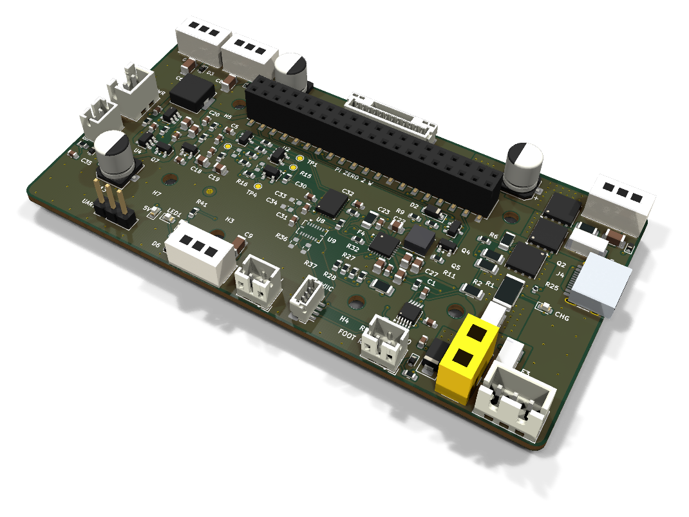
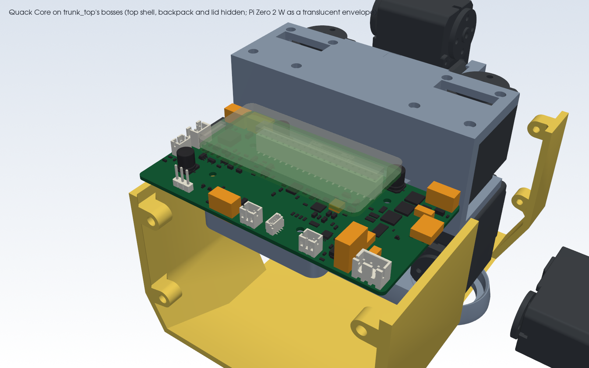
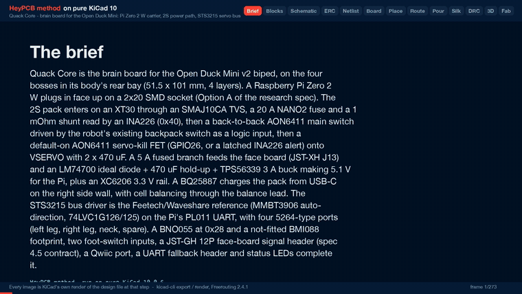

# Quack Core

The brain board for the Open Duck Mini: a Pi Zero 2W carrier with the 14-servo STS bus, a fused and switched 2S power path laid in stitched copper zones, USB-C charging with balancing, and the IMU.

Part of [HeyPCB's open robot boards](https://github.com/HeyPCB). Designed end to end with the HeyPCB method on
KiCad 10 (headless pipeline, Freerouting 2.4.1); every number below is measured on the files in this repository.
Mentions of `./run.sh`, `docs/rules/`, `blocks/` or `parts/` refer to the heypcb-kicad SDK that produced them.

<p align="center"></p>
<p align="center"></p>

| Layers | Outline | Parts | Nets | Connections routed | Vias | ERC errors | DRC errors / unconnected / parity |
|---|---|---|---|---|---|---|---|
| 4 | 101 x 51.5 mm | 138 | 78 | 312 -> 0 open | 224 | 0 | 0 / 0 / 0 |

**Not fabricated, assembled or powered.**

| | |
|---|---|
| KiCad project | [`kicad/`](kicad/) |
| Gerbers (unzipped and zipped), BOM, CPL, STEP, schematic PDF | [`fab/`](fab/) |
| Printed parts (STEP/STL), CadQuery source, fit report | [`cad/`](cad/) |
| Renders | [top](media/top.png), [bottom](media/bottom.png) |
| Design process, every step as KiCad rendered it | [`media/design-process.mp4`](media/design-process.mp4) |

<p align="center"></p>

Quack Core is a brain board for the Open Duck Mini (v2), the open-source miniature biped by Antoine
Pirrone and contributors. It is a carrier for a Raspberry Pi Zero 2 W and it bolts onto the four
existing `trunk_top` bosses in the duck's rear bay. It takes the 2S pack through a 20 A fuse, a
1 mOhm shunt and a back-to-back P-FET switch, drives the STS3215 servo bus, and charges and balances
the pack from USB-C. It was designed with the HeyPCB method on KiCad 10 (10.0.6), by heypcb-kicad's
headless pipeline with Freerouting 2.4.1, from the brief in `board.json` and the research spec
`robots/research/duck/spec.md` (Option A).

**This board has not been fabricated, assembled or powered.** Everything below is what KiCad, the
pipeline and the CAD scripts measured on the design files. Nothing here has been tested on
hardware or in the robot, and nothing here contains or tests software.

## Specs

- **Pi Zero 2 W carrier.** The Pi plugs in face-up on a 2x20 SMD socket (PM254-2-20-S-8.5,
  C3975165), 8.5 mm tall, on four M2.5 standoffs (not supplied) on its 58 x 23 mm hole pattern.
  The board's 5.1 V back-powers the Pi through header pins 2 and 4. Do not also plug the Pi's PWR
  micro-USB.
- **Pack input:** a vertical XT30 (J2), an SMAJ10CA bidirectional TVS (D1), a 20 A Littelfuse
  NANO2 (F1, 0451020.MRL) and a 1 mOhm 3 W 2512 shunt (R1). An INA226 at 0x40 reads the shunt and
  the pack voltage; its ALERT goes to GPIO4 and to the servo-kill latch.
- **Main switch:** two AON6411 P-FETs, source to source (Q1, Q2). The robot's existing backpack
  slide switch is re-used as a logic switch on J5 and carries about 80 uA. A reversed pack leaves
  both FETs off.
- **Servo power:** a third AON6411 (Q3) switches VSYS onto VSERVO. It is on by default: GPIO26 (with
  a 100 k pull-down) or a latched INA226 ALERT turns it off. VSERVO has 2 x 470 uF / 16 V bulk
  (C10, C11) and 10 uF plus an ESD5Z5.0 on DATA at each port.
- **Servo bus:** an exact copy of the Waveshare Bus Servo Adapter (A) / Feetech reference half-duplex
  driver (74LVC1G126 + 74LVC1G125 + MMBT3906) on the Pi's PL011 UART (GPIO14/15), with the
  spec's additions: 0 ohm source-select links, a J16 header for an external USB-UART, a DNP RTS
  link, a DNP DATA pull-up and four DNP test pads.
- **Servo ports:** four 5264-type 3-pin headers (HC-5264-3A, C2845815), DATA / VSERVO / GND: J6 left
  leg, J7 right leg, J8 neck chain, J9 spare.
- **Pi rail:** an LM74700 + AO3400A ideal diode with 470 uF hold-up behind the 5 A face/aux fuse
  (F2), then a TPS56339 3 A buck to 5.10 V (53.6 k / 10 k on a 0.802 V reference) and an XC6206
  3.3 V LDO for the board's logic.
- **Charger:** BQ25887 2S boost charger from USB-C (J4, HRO TYPE-C-31-M-12, 5.1 k on each CC, a plain
  sink) through a 2 A PTC (F4), with cell balancing through the balance lead's mid tap (J3 pin 2).
  Input limit 1.48 A (750 ohm on ILIM). It taps the pack ahead of the switch through a 5 A NANO2
  (F3), so it charges with the robot switched off. Orange CHG LED, /INT to GPIO16.
- **IMU:** BNO055 at 0x28 (fitted) and a BMI088 footprint at 0x18/0x68 (not fitted).
- **Face link** (the shared contract with the Quack Face board, spec 4.5): J12 JST-GH 12P top entry,
  J13 JST-XH 2P with the fused battery rail.
- **Other I/O:** foot switches on J10/J11 (JST-PH 2P, 1 k / 100 nF RC and ESD), a Qwiic port (J14,
  JST-SH 4P top entry, 3.3 V), green 5V LED, red LED1/LED2 on GPIO5/GPIO6.
- **Board:** 101 x 51.5 mm (CAD x -93.5 to -42.0, y -50.5 to +50.5), 1.6 mm, 4 copper layers.
  F.Cu signal with a GND pour, In1 a GND plane, In2 signal with a VSERVO pour, B.Cu signal with a
  GND pour, and the power path laid as stitched copper zones on F.Cu, In2 and B.Cu (see *Power
  zones*). Single-sided assembly. Four non-plated 2.7 mm holes for M2.5 screws on the bosses, and
  four more for the Pi's standoffs. The front edge is notched 0.8 mm between CAD y -28.25 and
  +28.25 to clear the `trunk_top` chamfer (see *CAD fit*).

## Option A: the Pi moves into the body

Today the Pi Zero 2 W, its 5 V UBEC and the amplifier sit on the head's ceiling, and a harness
through the 4-DOF neck carries 7.4 V, USB, I2C and the foot-switch wires down to the body (spec
1.4). Quack Core takes the research spec's Option A (spec 2.6): the Pi plugs into this board, in the
body, next to the battery, the servo bus, the IMU and the foot switches. What that changes:

- **Update the URDF masses before retraining.** The Pi (about 10 g) and the UBEC (about 15 g,
  replaced here by the on-board buck) leave the head and join the trunk. Both figures are the
  spec's estimates. The walk policy was trained on the URDF's mass properties (`head_assembly`
  352.6 g, `trunk_assembly` 698.5 g), so update both links, add this board's own mass to the trunk,
  and retrain (spec 2.6, 7). This board's mass was not measured.
- **Camera.** CSI would have to cross the +/-160 degree head-yaw joint. Either run a round
  CSI-to-HDMI extension through the neck (Arducam B0091, with a 22-to-15-pin cable at the Pi), or
  leave the camera off. The walk runtime does not use it (spec 2.6).
- **Runtime: configuration only** (spec 3.10). No Python changes:
  1. `/boot/firmware/config.txt`: `enable_uart=1` and `dtoverlay=miniuart-bt`. The PL011 moves to
     GPIO14/15 and Bluetooth stays up for the gamepad. 1 Mbps is 48 MHz / 16 / 3 exactly.
  2. `cmdline.txt`: remove `console=serial0,115200`.
  3. A udev rule, `KERNEL=="ttyAMA0", SYMLINK+="ttyACM0"`, so the hard-coded `/dev/ttyACM0` in
     the runtime still opens the bus (or edit those defaults).
  4. Keep `dtparam=i2c_arm=on`. If the BNO055 reads glitch, apply Adafruit's `i2c_arm_baudrate`
     fix for its clock stretching.
  5. Keep the I2S amplifier overlay. Every GPIO number the runtime uses is unchanged.
- **The neck harness** becomes J12 (12 signals), J13 (the fused battery rail for the face board's
  own 5 V) and the neck servo chain on J8.
- **Wi-Fi and Bluetooth** move inside the PLA body, next to the cells. The spec estimates this as
  acceptable but slightly worse.
- **No first-hand report** of an STS3215 bus on a Pi's GPIO UART at 1 Mbps was found (spec 3.10).
  J16 and two 0 ohm links are the fallback: remove R17 and R18 and drive the same buffer from a
  3.3 V USB-UART on J16 (1 GND, 2 TXD into the board, 3 RXD out of it).

## Pinouts

### Pi Zero 2 W header (J1)

The 2x20 socket's footprint is the mirror image of the Pi's header (socket pad 2n-1 meets Pi pin
2n), so the block wires each socket pad to the net of the Pi pin it meets. The table is in Pi pin
numbers. Every GPIO number the walk runtime uses is the one it uses today (spec 3.8).

| Pi pin | GPIO | Net | Pi pin | GPIO | Net |
|---|---|---|---|---|---|
| 1 | 3V3 out | not connected | 2 | 5V | 5V (board's 5.10 V in) |
| 3 | GPIO2 | I2C_SDA | 4 | 5V | 5V |
| 5 | GPIO3 | I2C_SCL | 6 | GND | GND |
| 7 | GPIO4 | INA_ALERT | 8 | GPIO14 | UART_TX (servo bus) |
| 9 | GND | GND | 10 | GPIO15 | UART_RX (servo bus) |
| 11 | GPIO17 | UART_RTS (DNP link to TXEN) | 12 | GPIO18 | I2S_BCLK |
| 13 | GPIO27 | FOOT_R | 14 | GND | GND |
| 15 | GPIO22 | FOOT_L | 16 | GPIO23 | EYE_R |
| 17 | 3V3 out | not connected | 18 | GPIO24 | EYE_L |
| 19, 21, 23 | GPIO10, 9, 11 | not connected | 20 | GND | GND |
| 25 | GND | GND | 22 | GPIO25 | PROJ |
| 27, 28 | GPIO0, 1 (ID EEPROM) | not connected | 24, 26 | GPIO8, 7 | not connected |
| 29 | GPIO5 | LED1 | 30 | GND | GND |
| 31 | GPIO6 | LED2 | 32 | GPIO12 | ANT_R |
| 33 | GPIO13 | ANT_L | 34 | GND | GND |
| 35 | GPIO19 | I2S_LRCLK | 36 | GPIO16 | CHG_INT |
| 37 | GPIO26 | SERVO_KILL | 38 | GPIO20 | I2S_DIN |
| 39 | GND | GND | 40 | GPIO21 | I2S_DOUT |

I2C1 carries the BNO055 (0x28), the INA226 (0x40), the BQ25887 (0x6A or 0x6B, see *Check before
ordering*), the BMI088 footprint (0x18 / 0x68) and the Qwiic port. The board adds no I2C pull-ups:
the Pi's own pull-ups on GPIO2/3 serve the bus.

### Face link: J12 and J13 (the contract with Quack Face)

Both match the Quack Face board (commit 250de3c on `robot-quack-face`), whose harness runs pin n
to pin n.

**J12**, JST-GH 12-pin top entry, BM12B-GHS-TBT (C2983891), spec 4.5 unchanged:

| Pin | Net | Pin | Net |
|---|---|---|---|
| 1 | GND | 7 | GND |
| 2 | I2S_BCLK (GPIO18) | 8 | EYE_L (GPIO24) |
| 3 | GND | 9 | EYE_R (GPIO23) |
| 4 | I2S_LRCLK (GPIO19) | 10 | PROJ (GPIO25) |
| 5 | I2S_DOUT to the amplifier (GPIO21) | 11 | ANT_L (GPIO13) |
| 6 | I2S_DIN from the microphone (GPIO20) | 12 | ANT_R (GPIO12) |

The two mounting pads are on GND. The spec named the side-entry SM12B-GHS-TB. The board's front
edge sits 1.9 mm from `trunk_top`'s rear wall, so a side-entry plug facing forward could not be
inserted. The top-entry part has the same housing and pinout.

**J13**, JST-XH 2-pin (B2B-XH-A, C158012): **pin 1 VBAT** (VBAT_AUX, the pack after the main switch
and the 5 A fuse F2), **pin 2 GND**. F2 also feeds the Pi rail. The spec's face worst case (about
2.6 A at the pack) plus the Pi (about 1.4 A) is below 5 A.

### Other connectors

Positions are body centres, in the CAD frame of the print STLs (+x forward, +y the robot's left,
mm), read off the final board.

| Ref | Function | Part (LCSC) | Pin 1 / 2 / 3 | Centre (x, y) |
|---|---|---|---|---|
| J2 | Pack in | AMASS XT30UPB-M vertical (C428721) | - (GND, the chamfered end) / + (VBAT_IN) | (-87.3, -35.0) |
| J3 | Balance lead | JST-XH 3P B3B-XH-A (C144394) | not connected / mid tap / not connected | (-90.0, -44.0) |
| J4 | USB-C charge input | HRO TYPE-C-31-M-12 (C165948) | VBUS, CC1/CC2 5.1 k to GND, no data | (-62.0, -47.2), mouth 0.95 mm past the right edge |
| J5 | Backpack switch (logic) | JST-PH 2P (C131337) | SW_N / GND (closed = on) | (-90.5, +1.0) |
| J6 | Servo bus, left leg | HC-5264-3A (C2845815) | DATA / VSERVO / GND | (-45.3, +43.7) |
| J7 | Servo bus, right leg | HC-5264-3A | DATA / VSERVO / GND | (-45.3, -44.7) |
| J8 | Servo bus, neck chain | HC-5264-3A | DATA / VSERVO / GND | (-45.3, +32.5) |
| J9 | Servo bus, spare | HC-5264-3A | DATA / VSERVO / GND | (-90.4, +12.2) |
| J10 / J11 | Foot switch L / R | JST-PH 2P | switch (GPIO22 / GPIO27 through 1 k) / GND | (-74.0, +47.1) / (-90.5, -22.5) |
| J14 | Qwiic (3.3 V I2C1) | JST-SH 4P top entry BM04B-SRSS-TB (C160390) | GND / 3V3 / SDA / SCL | (-88.9, -7.8) |
| J16 | External UART for the bus | 1x3 2.54 mm (C2937625) | GND / TXD in / RXD out | (-89.5, +32.0) |

J2's polarity is the footprint's: KiCad's AMASS XT30UPB-M footprint prints - beside pad 1, at the
housing's chamfered end, and + beside pad 2, and the chamfered side of an XT30 is its negative
contact. Pad 2 (+) faces F1; pad 1 (-) is at the rear edge.

J3 uses only the balance lead's mid tap. Its B- pin is the cell side of the pack's BMS: tying it to
the board's ground would bypass the BMS's discharge FETs. So pins 1 and 3 are not connected.

## Power path and what the copper carries

```
J2 XT30 ─┬─ D1 SMAJ10CA ─ GND
         ├─ F3 5 A ─ BQ25887 BAT (charger, J4 USB-C, J3 mid tap)
         └─ F1 20 A ─ R1 1 mOhm (INA226 0x40) ─ Q1 ┐ AON6411 back to back, gates on J5
                                                Q2 ┘
                                                 │ VSYS
              ┌──────────────────────────────────┼──────────────────────────┐
         Q3 AON6411 servo kill              F2 5 A ─ VBAT_AUX ─ J13 (face)    R8 / Q4 / Q5 gate drive
         (GPIO26, INA226 ALERT)                      └─ LM74700 + AO3400A ─ 470 uF ─ TPS56339 5.10 V ─ Pi pins 2/4
              │ VSERVO                                                               └─ XC6206 3.3 V
         C10, C11 470 uF; J6, J7, J8, J9 (10 uF + ESD5Z each)
```

The pack current runs in a straight column down the board's right side: the XT30 at the rear, then
F1, R1, Q1, Q2 and Q3 one above the other, with Q3's drain at the front, beside C10 and J7. The
FETs face source row to source row, so QS and VSYS are three short stubs each.

**Net classes** (from the brief; a class with a current is never narrowed by the routing ladder):
BATT 3.0 mm (VBAT_IN, VBAT_F, VBAT_SH), FETLINK 1.2 mm (QS, VSYS, limited by the AON6411's 0.5 mm
source leads), SERVO 2.5 mm with 2.2 / 1.2 mm vias (VSERVO), AUX 0.8 mm (VBAT_AUX, VPI_IN, 5V,
BUCK_SW), USBPWR 0.6 mm (VBUS), CHG 0.4 mm (the charger's power nets). The tracks only connect the
path; the current is carried by the zones below.

### Power zones

After routing reaches 0 open, the pour stage lays the brief's `board.zones`: each a named net's
copper over a region on chosen layers, above the plan pours, with every pad joined solid (no
thermal spokes), and, where the zone has a `stitch` pitch, its own via lattice. Board coordinates
are mm from the outline's top-left corner; every reason is also in `board.json`.

| Zone | Net | Layers | Region | Vias (0.6 / 0.3 mm, 1.2 mm pitch) |
|---|---|---|---|---|
| `vbat_in` | VBAT_IN | F.Cu, B.Cu | J2's + pad, F1's input pad, F3 and the TVS (x 79-93, y 35.75-45.25) | 13 |
| `vbat_f` | VBAT_F | F.Cu, B.Cu | F1's output pad to the shunt (x 79.9-90.2, y 27.9-35.6), stepped round the Pi standoff at (79.5, 35.5) | 12 |
| `vbat_sh` | VBAT_SH | F.Cu, B.Cu | the shunt to Q1's drain (x 79.9-90.2, y 18.45-27.75) | 9 |
| `qs` | QS | F.Cu | the 0.7 mm gap between Q1's and Q2's source rows (x 79.9-88.3, y 15.65-18.15) | none: no via fits outside the FETs' courtyards |
| `vsys` | VSYS | F.Cu, B.Cu | Q2's drain to Q3's sources, F2 and R8 (x 82.6-94.5, y 8.8-15.45) | 7 |
| `vservo_q3` | VSERVO | F.Cu, In2 | Q3's drain to C10, J7's V pin and C7 (x 67.6-97.6, y 0.85-9.7), J7's DATA and GND pins left out | 26 |
| `vservo_q3_b` | VSERVO | B.Cu | Q3's corner on B.Cu, stopping at x 90.6 | (shares `vservo_q3`'s) |
| `vservo_band_in2`, `vservo_band_b` | VSERVO | In2; B.Cu | along the front edge to C11, J8 and J6; on B.Cu also under the Pi socket (y to 16.6) | none (a lattice there would perforate In1's GND under the ports) |
| `gnd` | GND | F.Cu, B.Cu | the whole board under the zones above | 55, at 4 mm |

The `gnd` zone exists to join the XT30's - pad and the ports' GND pins solid. Any GND zone makes
the plan's GND stitcher place nothing (it wants each via's ring inside every GND fill), so the
`gnd` zone stitches GND itself; the plan's own stitching count reads 0. J7's GND pin sits between
Q3 and J7's V pin, so on any one layer only one of the two nets can pass it: VSERVO reaches J7
on F.Cu and In2, and J7's GND leaves on B.Cu, down the right edge to the XT30.

### Measured copper on the current path

`copper.py` (KiCad's Python) lists every track, via and pour of each power net on the final board
and exports the copper (tracks, pads, plan pours and zones) as polygons. `copper_cut.py` (the
robots CAD environment, it needs scipy) rasterises that copper on a 0.1 mm grid and finds, for
each link of the path, the **narrowest cross-section the link's whole current must pass**: a
max-flow / min-cut from the link's source pads to its sink pads, over every layer, with tracks,
zones and via barrels together, in parallel. Outer copper is taken as 35 um, inner as 17.5 um
(JLCPCB's standard 4-layer build), via plating as 25 um. Each cut is rated with
`heypcb_kicad.route.ipc2221_amps` (IPC-2221, I = k dT^0.44 A^0.725), per layer, summed. Each link
is cut a second time with the copper within 1 mm of its pads counted as the pads ("beyond the
pads"): that rates the board's own copper between the parts, apart from the parts' fixed lands.

| Link | From, to | Narrowest cross-section (35 um equivalent) | 10 C rise | **20 C rise** | Beyond the pads, 10 C / 20 C |
|---|---|---|---|---|---|
| VBAT_IN | J2 pad 2 to F1.1 | 8.75 mm: F.Cu 6.73, via barrels 2.02 | 13.5 A | **18.3 A** | 15.3 A / 20.8 A |
| VBAT_F | F1.2 to R1.1 | 8.29 mm of F.Cu, at the fuse's output pad | 11.1 A | **15.0 A** | pads 0.9 mm apart |
| VBAT_SH | R1.2 to Q1 drain | 8.38 mm: F.Cu 7.71, a barrel 0.67 | 12.3 A | **16.7 A** | pads 0.9 mm apart |
| QS | Q1 sources to Q2 sources | 3.71 mm of F.Cu: the 0.7 mm gap between the two rows of 0.5 mm source leads | 6.2 A | **8.4 A** | leads 0.7 mm apart |
| VSYS | Q2 drain to Q3 sources | 4.19 mm of F.Cu, at Q3's three source leads | 6.8 A | **9.2 A** | pads 0.7 mm apart |
| VSERVO, all ports | Q3 drain to J6-J9 pin 2 | 13.00 mm: F.Cu 2.41, In2 1.43, B.Cu 9.17 | 18.0 A | **24.4 A** | 18.9 A / 25.7 A |
| VSERVO, right leg | Q3 drain to J7.2 | 3.84 mm: F.Cu 2.41, In2 1.43 | 6.1 A | **8.2 A** | 7.0 A / 9.5 A |
| VSERVO, left leg + neck | Q3 drain to J6.2, J8.2 | 8.65 mm: In2 1.79, B.Cu 6.86 | 11.5 A | **15.6 A** | 11.5 A / 15.6 A |
| VSERVO, spare | Q3 drain to J9.2 | 2.66 mm: In2 0.35, B.Cu 2.31 (its routed track) | 4.9 A | **6.7 A** | 4.9 A / 6.7 A |
| GND, all ports | J6-J9 pin 3 to J2 pad 1 | 11.75 mm: F.Cu 4.05, In1 0.65, In2 0.07, B.Cu 6.99 | 17.4 A | **23.7 A** | 21.3 A / 28.9 A |
| GND, right leg | J7.3 to J2 pad 1 | 4.72 mm: B.Cu 4.00, In1 0.65, In2 0.07 | 7.6 A | **10.3 A** | 10.0 A / 13.6 A |
| GND, left leg + neck | J6.3, J8.3 to J2 pad 1 | 10.97 mm: F.Cu 9.61, In1 1.29, In2 0.07 | 13.9 A | **18.9 A** | 16.2 A / 22.0 A |

*Read off the board* (`copper_cut.json`, `copper.json`) from the full run with
media. Before the zones, the same measurement gave 4.9-8.0 A at a 10 C rise for every link (the
servo rail crossed one 1.2 mm via; the battery path was 3.0 mm tracks).

**What this says about 15 A** (the spec's design point: 15 A continuous, 30 A peaks; simulated
walking 13.5-14.4 A, spec 3.9). At a 20 C rise on 1 oz outer copper:

- **The battery side reaches it:** VBAT_IN 18.3 A, VBAT_F 15.0 A, VBAT_SH 16.7 A. VBAT_F and
  VBAT_SH end on pads 0.9 mm from the next part's pads (fuse to shunt, shunt to Q1), so their
  narrowest section is the copper alongside those pads; the zones already surround them.
- **The servo rail reaches it in total** (24.4 A from Q3 to the four ports, GND return 23.7 A),
  and per side as the load divides: the left leg and neck 15.6 A, the right leg 8.2 A (VSERVO)
  and 10.3 A (GND), the spare port 6.7 A. The right leg is the narrow one: J7's GND pin sits in
  the path, so its VSERVO uses only F.Cu and In2 and its GND only B.Cu and In1. With the walking
  load divided over two legs (about 5-7 A each, **estimated** from spec 3.9), each leg's port has margin; a single
  leg near its servos' stall current does not.
- **The two links between the back-to-back FETs do not: QS 8.4 A and VSYS 9.2 A.** They end on
  the AON6411's three 0.5 x 0.66 mm source leads per FET. Whatever is poured, the copper that can
  touch those leads is about 3.7-4.2 mm wide on F.Cu (the slot to the drain pad is 0.67 mm, and no
  via fits inside the package's courtyard). That is a property of the 5 x 6 mm DFN package. These
  links are 0.7 mm long, lead to lead; IPC-2221's chart is for long conductors, and a sub-
  millimetre bridge between two FET packages sheds its heat into them, so this rating says little
  about the real limit. It was not measured. A part whose source is a wide tab (or two FETs in
  parallel per side) would raise it.

**This board demonstrates about 15 A at a 20 C rise on everything except the 0.7 mm FET-to-FET
bridges (8.4-9.2 A by this rule) and the per-leg ports (8.2-15.6 A).** Nothing here is a measured
temperature; measure Q1-Q3, F1, R1 and the XT30 under load before trusting a continuous rating.
The path parts themselves are sized for the design point by the spec (3.9): F1 20 A, FETs of
40 A or more, the 3 W 2512 shunt (0.23 W at 15 A), the XT30. The 5264-type servo headers are
rated 3 A per pin (spec 3.4), which a leg chain can exceed while walking, as on the Waveshare
adapter the duck uses today. 2 oz outer copper would raise the outer-layer share of each figure by about 65 % (2^0.725).

**The rest of the power copper**, *read off the board*: VBAT_AUX 0.8 mm (117.9 mm, 4 vias of
0.8 / 0.4 mm, on F.Cu, In2 and B.Cu), 5V 0.8 mm (43.9 mm, F.Cu), VBUS 0.6 mm (45.8 mm, 2 vias, mostly
on In2), VBAT_CHG 0.4 mm (30.6 mm, 2 vias). IPC-2221 at a 10 C rise on 1 oz outer copper:
0.8 mm 2.0 A, 0.6 mm 1.7 A, 0.4 mm 1.2 A; on 0.5 oz inner copper they carry less. The charger's
input is limited to 1.48 A by its ILIM resistor.

## Where the board differs from the spec

| Spec | On the board | Why |
|---|---|---|
| THT 2x20 socket C2977589, or leads clipped to 2 mm | **SMD** socket PM254-2-20-S-8.5 (C3975165), `PinSocket_2x20_P2.54mm_Vertical_SMD` | The socket sits over `trunk_top`'s tongue, where the gap under the board is 3.0 mm (spec 2.7) |
| SMBJ10A-class unidirectional TVS (no LCSC number resolved) | **SMAJ10CA**, bidirectional, 400 W (C19077530) | Found in a live lookup. Bidirectional, so a reversed pack does not drive it into forward conduction; the back-to-back FETs block the reversed pack |
| JST-GH SM12B-GHS-TB side entry (not resolved) | **BM12B-GHS-TBT** top entry (C2983891) | Side entry cannot be plugged at the front edge (see *Face link*). Same pinout; matches Quack Face |
| Qwiic SM04B-SRSS-TB side entry | **BM04B-SRSS-TB** top entry (C160390) | The port is at the rear edge; a side-entry plug there would face the battery lid, 1.5 mm behind the board |
| BQ25887 VBUS straight from the receptacle | **2 A PTC** (1206L200/16NR, C22374899) between them | Splits VBUS into the receptacle's 0.6 mm net and the 0.4 mm net that enters the VQFN pin; limits a shorted cable to the source's rating |
| BMI088 SDO1 / SDO2 to GND | through two **0 ohm links** (R36, R37, not fitted with the BMI088) | KiCad's symbol types SDO1/SDO2 as outputs; ERC refuses an output tied to a rail |
| J15 2x5 expansion header, DNP ID EEPROM, DNP pogo pins to the Pi's USB pads | **not on this board** | Left out of this revision. GPIO7-11 and GPIO0/1 are not connected |
| Connector positions (spec 2.7 table, "final placement is up to layout") | J6, J7 and J8 along the front edge, J8 beside J6 rather than at the centre (J12 sits there); J5, J9, J11, J14 and J16 along the rear edge; J10 and J13 on the left edge | Every through-hole lead is behind the tongue's end (x < -90.1) or outside its width (\|y\| > 26). Cable routing to each opening was not checked |

Everything else follows the spec's parts table (spec 6): BNO055, the Waveshare/Feetech bus driver
parts, TPS56339, XC6206, LM74700 + AO3400A, AON6411 x 3, INA226, the 1 mOhm 2512 shunt, NANO2
fuses, BQ25887, HRO USB-C, XT30, HC-5264-3A, JST-XH, JST-PH. Part numbers came from live jlcsearch
lookups on 2026-10-02 and are pinned in `parts/lcsc_pinned.json` with that date.

## What it measured

A full run with media on 2026-10-03 (`./run.sh --board boards/quack_core`, KiCad 10.0.6,
Freerouting 2.4.1). Gate numbers are from `report.json`. Anything marked *read
off the board* was measured on `kicad/quack_core.kicad_pcb` with KiCad 10.0.6's `pcbnew`.

| Gate | Result |
|---|---|
| Composition | 138 parts, 78 nets, 28 no-connects (20 block instances of 15 distinct blocks, all new `quackcore_*` blocks) |
| Part binding | 119 of 138 parts bound to an LCSC number, 0 unsourced, 0 identity conflicts. The other 19 are not BOM parts: the eight mounting holes and the not-fitted parts (BMI088 U9 with C33, C34, R36, R37; R19, R20; TP1-TP4). 34 distinct Extended parts, about $102 in JLC loading fees |
| ERC (`kicad-cli sch erc --severity-all`) | 0 errors, 0 warnings |
| Netlist round trip | identical, 78 nets |
| Routing, rung 1, fanout on | **312 -> 0 open** by Freerouting alone (0 at its pass 11), 363.1 s, 109 vias; the last-mile router had nothing to do. **This solve is kept**. The zones come after routing, so the route is the same as before them (1229 tracks, 109 vias) |
| Routing, rung 1, fanout off | 19 open, 137.0 s, 110 vias |
| Net classes | none narrowed (the power classes carry a current and are never narrowed) |
| Copper | 1229 tracks, 2836.2 mm (F.Cu 1435.1, In2 1098.7, B.Cu 302.4), 109 routing vias |
| Pours and zones (laid only after a measured 0 open) | Plan: GND on F.Cu, B.Cu and In1, VSERVO on In2. The ten `board.zones` above them (see *Power zones*), with 122 zone vias: GND 55, VSERVO 26, VBAT_IN 13, VBAT_F 12, VBAT_SH 9, VSYS 7. The plan's GND stitcher placed 0 (see *Power zones*). 0 open after the pours and after stitching, 0 island-repair vias |
| Silkscreen | 12 words placed (see *Check before ordering*), 57 designators seated and 68 hidden, 6 back-side title lines placed one by one. The text displaced 7 stitching vias, which leaves 224 vias on the board (*read off the board*: 213 of 0.6 / 0.3 mm, 6 of 0.8 / 0.4, 3 of 2.2 / 1.2, one each of 1.2 / 0.6 and 1.0 / 0.5). 21 footprint silk strokes at or past the edge were dropped |
| DRC (`kicad-cli pcb drc --severity-all --schematic-parity`) | **fresh, 0 errors, 0 unconnected, 0 parity issues**, 8 warnings |
| DFM (`jlcpcb_4layer`) | 0 errors, 1 warning: 517 stock-footprint silk strokes at 0.10 mm, which the fab prints at its 0.15 mm minimum |
| Fab gate | **ready**, no blockers. 4 copper gerbers and a gerber job with LayerNumber 4, 1.6 mm. The JLC CPL corrected 14 rotations |
| 3D, renders, video | all ran: 63 3D frames, the renders (168.5 s) and the design-process video (273 stills; 180.2 s at 1920 x 1080 by ffprobe) |

- **The 8 DRC warnings**: 7 `lib_footprint_mismatch` (J3, J4, J7, J8, J9, C10, C11: all seven sit
  at the board edge, where the silk clip dropped their strokes) and 1 `silk_over_copper`: the
  XT30 footprint's own "+" sits on the edge of F1's pad. The two `via_dangling` warnings of the
  run before the zones (the vias in Q1's and Q2's drain pads) are gone: the zones join them.
- Nothing on the board was edited by hand: every track came from Freerouting, every pour and
  stitching via from the pipeline.

### Why the brief looks the way it does

Measured on the runs of 2026-10-02; each reason is also in `board.json` beside the key.

- **The power column is locked part by part.** XT30, F1, R1, Q1, Q2 and Q3 sit on one line, each
  pad facing the next. Q2 is offset from Q1 by one lead pitch (1.27 mm): aligned, Freerouting ran
  Q2's gate line through the 0.67 mm slot between Q1's source leads and drain pad and cut off Q1's
  source lead 1. Thin track keep-outs along those slots (`q1_source_slot` and two more) keep gate
  lines out without blocking the source net; a keep-out over the whole slot left 6 open.
- **FETLINK is 1.2 mm.** At 1.4 mm with 0.25 mm clearance the class could not reach Q1's own
  0.5 mm source leads.
- **The charger sits under the Pi with every satellite locked.** Beside the USB-C, one of its
  analog pins (TS, ILIM, MID, CBSET, REGN) was left open on each of three builds; under the Pi with
  the resistors on the placer's shelves, ILIM and MID; with the 2.2 k LED resistor where the placer
  put it, under the TS / ILIM / MID pins, MID. Now the four resistors of those pins sit in a fan
  below them and the LED resistor right of the capacitors.
- **J9's pin 1 is at board x 35.77** (its body centre at CAD y +12.2). In the rear-left corner its DATA line was left open
  once. At x 34.5 the placer put its 10 uF on the DATA side of the header, where the 2.5 mm VSERVO
  class could not reach it between the pins and the edge. 1.27 mm to the right, the placer put the
  capacitor beside the boss, and Freerouting routed all 312 connections itself.
- **The routing was searched in parallel copies.** Ten candidate briefs each ran from `compose` in
  their own `--build` directory, three or four at once. Three reached 0 open: one with router
  shorts left in (not eligible), one only after the last-mile router, and this one, which
  Freerouting routed alone. The board's own runs then rebuilt it from this brief and routed it the
  same way.
- **The XT30's pads were swapped late.** The first revision of `quackcore_power_in` put the pack +
  on pad 1. The silkscreen check showed the footprint's own "-" printed beside that pad: KiCad's
  AMASS footprint marks pad 1, at the housing's chamfered end, as the negative contact, which is
  the XT30's convention. The block now has GND on pad 1 and VBAT_IN on pad 2, and J2 is turned
  180 degrees so the + pad still faces F1. Every number in this README is from the run after the
  swap.
- **The power path is zones, not tracks** (added 2026-10-03, once the pipeline had `board.zones`).
  The tracks still route first and every gate is unchanged; the zones then took every link from
  4.9-8.0 A to the figures in *Power path* (10 C rise). What shaped them: one zone per net with
  distinct priorities (overlapping zones of one net at one priority are a DRC `zones_intersect`
  error); VBAT_F's zone follows the Pi standoff's keep-out circle, because a square notch there
  set its cut at 7.5 mm (14.0 A at 20 C) and the stepped edge at 8.3 mm (15.0 A); VSERVO stops
  at x 90.6 on B.Cu so that J7's GND pin keeps B.Cu ground (inside the VSERVO zone its only
  ground was In1's thermal spokes, 1.4 A); the GND zone stays off In1 (on In1 it left slivers of
  the plane, DRC `isolated_copper`); and the front band is not stitched, so In1's ground under
  J6 and J8 stays whole.
- **The board's front edge has a 0.8 mm notch**, from the CAD fit (see *CAD fit*).

## CAD fit in the duck

`cad/fit.py` (the robots CAD environment: CadQuery, trimesh, manifold3d, VTK) places the
pipeline's own STEP (`fab/quack_core.step`) in the CAD frame of the Open Duck Mini
v2 print STLs, adds an envelope for each part whose KiCad 3D model is missing (named in `fit.json`,
with its source) and a Pi Zero 2 W envelope on the socket, and measures against every body part:
the print STLs and the URDF's servo cases, horns, cells, holder, BMS and power switch. Clearance
is the smallest distance between points sampled 0.25 mm apart on the assembly and on the body, in
both directions; a sample inside a body counts as interference. The board's bottom face resting on
the four boss tips is the seating, checked separately. Numbers from `cad/fit.json`:

| Check | Result |
|---|---|
| Holes on the bosses | all four within **0.01 mm** of the boss pilots, found by ray casting (pilot 1.99 mm, tips at z -6.10, the board's bottom face) |
| Interference with any body part | **none** |
| Smallest clearance | **0.49 mm**, board edge to `trunk_top`'s tongue chamfer at the front notch (x -42.8) |
| `body_middle_top` (side walls) | 0.55 mm, USB-C receptacle mouth to the uncut wall; **2.1 mm** to the B2 part with its opening |
| `battery_pack_lid` | 1.5 mm, board rear edge |
| `body_back` | 2.16 mm, board corner |
| Servo cases, horns, cells, holder, BMS, power switch, `body_middle_bottom` | more than 4 mm |
| Below the board | through-hole leads 1.8 mm below the bottom face (KiCad's models), against a 3.0 mm gap over the tongue; every lead is behind the tongue's end or outside its width |
| Free height above each connector (board top to the first body surface) | J2 40.5, J3 18.2, J4 29.0, J5 44.5, J6 35.6, J7 29.6, J8 44.5, J9 44.5, J10 29.2, J11 44.5, J13 29.7, J14 44.5, J16 39.3 mm; above J12 and the Pi socket no body surface (the roof opening) |
| Pi Zero 2 W envelope | x -81.0 to -51.0, y -32.5 to +32.5, its PCB 11.0 mm above the board top (8.5 mm socket + 2.5 mm header spacer), 3.45 mm of parts on it (estimated): no interference |

**The front notch.** The spec's rectangle put the board's front edge 0.11 mm into `trunk_top`'s
chamfer where the tongue meets the front wall (the edge sat at z -6.10 where the chamfer reaches
-5.99, measured on `trunk_top.stl`). The outline is set back 0.8 mm along the front edge for
\|y\| <= 28.25, which gives the 0.49 mm above.

**B2, the USB-C opening** (spec 5). `fit.py` cuts a 13.0 x 7.5 mm opening with 1.5 mm corner radii
through the right-hand (-y) side wall of `body_middle_top`, centred on the receptacle at
x -62.0, z -2.87 (spec: x -62.0, z -2.9), through y -51 to -56 (the wall is y -52 to -55). The
receptacle's mouth is at y -51.45, 3.55 mm inside the wall's outer face. 286.6 mm3 removed; the
result is watertight. It is `cad/body_middle_top_usbc.stl` (and a faceted STEP in
`cad/`), Apache-2.0 with the change notice in `cad/NOTICE`.

Preview renders (headless VTK), written by `fit.py` to `cad/`: `fit_iso.png` (the
board on the bosses, top shell hidden, the Pi as a translucent envelope), `fit_top.png` (front up,
the Pi hidden, envelopes in orange), `fit_section.png` (a section at y -14 through two bosses, seen
from the robot's right) and `fit_usbc.png` (the B2 opening with the receptacle behind it).

Envelopes, not vendor models: the XT30 (11 mm tall, **estimated**, no drawing read), the four
5264 headers (10 x 4.9 x 6 mm, LCSC row), the NANO2 fuses, the XFL4020 inductor and the USB-C
shell (8.94 x 7.35 x 3.26 mm).

## Check before ordering

The board passes ERC, the netlist round trip, DRC with schematic parity, DFM and the fab gate in
KiCad. **It has not been fabricated, assembled or powered.**

- **Current.** At a 20 C rise on 1 oz outer copper the battery side (15.0-18.3 A) and the servo
  rail in total (24.4 A, GND 23.7 A) reach the 15 A design point; the 0.7 mm bridges between the
  FETs' source leads (QS 8.4 A, VSYS 9.2 A) and the right-leg port (8.2 A) do not, by IPC-2221.
  See *Power path*. Before a walking test at full current, measure the temperature of Q1-Q3, F1,
  R1 and the XT30 under load; 2 oz outer copper is the cheap margin.
- **Pack BMS.** The duck's 8 A / 10 A BMS is the first limit: the spec asks for a 2S BMS rated
  20 A continuous or more, 40 A peak or more and 10 mOhm or less (spec 3.1). The XT30 is the
  pack connector, and the 2 x 470 uF bulk behind Q3 charges through the BMS each time the servos
  are switched on (Q3 turns on in tens of microseconds). Check the BMS's short-circuit trip
  against that inrush.
- **8.4 V on 7.4 V servos.** VSERVO is the pack voltage, up to 8.4 V on a full 2S pack. The STS3215
  is rated 4-7.4 V with an 8.0 V register limit (spec 1.3; whether shipped servos alarm at 8.0 V is
  an open item, spec 8). The BQ25887 charges to 8.4 V by default (REG00 resets to 4.20 V per
  cell). It runs with no host, with the robot switched off; to charge to 8.0 V, the Pi must write
  4.00 V per cell to REG00 and disable the watchdog (REG05 WATCHDOG = 00) while it runs. Those
  settings then hold until the pack is unplugged.
- **BNO055 axes.** The chip is turned so that pin 1 is at its rear-left corner. By the data sheet's
  placement figure that turns chip +X toward the robot's left and chip +Y toward its rear, which is
  what `raw_imu.py`'s remap needs for `imu_upside_down = false` (spec 3.6). This was read off a
  figure, not tested: check it against the figure (and on the bench, by tilting) before trusting
  the walk policy on this board.
- **BQ25887 I2C address.** TI's data sheet gives 0x6A in one place and 0x6B in another (SLUSD89B
  8.3.11 and 8.3.11.5). Scan the bus once before writing driver code.
- **Via in pad.** `route.via_in_pad_mm` put a via in every SMD pad 2.6 mm or wider: Q1, Q2 and Q3's
  drain pads (1.2 / 0.6, 1.0 / 0.5 and 2.2 / 1.2 mm) and the charger's exposed pad (0.6 / 0.3 mm).
  All four now join a zone on B.Cu. Open holes in a FET pad wick solder: order these vias filled
  and capped. The 122 zone vias sit outside every part's courtyard and need nothing special.
- **Envelopes.** The XT30's 11 mm height is an estimate (no drawing was read), and five other parts
  are envelopes from catalogue sizes (see *CAD fit*). The tightest measured gaps are 0.49 mm at the
  front notch and 0.55 mm at the USB-C mouth before the B2 cut.
- **Balance lead.** Only the mid tap (J3 pin 2) is used. Check that the pack's balance plug puts
  the mid tap on pin 2 (the usual B-, mid, B+ order) and that it mates with a JST-XH header.
- **No thermistor.** TS is a fixed divider at 55.4 % of REGN, between the data sheet's 10 C and
  45 C thresholds, so the charger always sees a normal temperature and never sees the pack's.
- **Pi rail.** The board back-powers the Pi through pins 2 and 4 at 5.10 V nominal. Never plug the
  Pi's PWR micro-USB at the same time. The Pi sits 11 mm above the board on a socket of 8.5 mm plus
  a 2.5 mm header spacer, on four 11 mm M2.5 standoffs (not on the BOM).
- **Inner copper.** The gerber job says 0.035 mm on every layer; that is KiCad's default
  stackup, not a fab quote. The copper ratings above assume JLCPCB's standard 0.5 oz inner layers.
- **Part numbers and stock.** The rows this board added were read live from jlcsearch on
  2026-10-02. On that date the BQ25887RGER had 987 in stock. Stock and Basic / Extended class go
  stale: re-check before ordering. The BOM has 34 distinct Extended parts (about $102 in JLC
  loading fees).
- **Silkscreen.** *Read off the board:* the front carries PI ZERO 2 W, FACE PWR, UART, SWITCH,
  QWIIC, FOOT R, 5V, LED1 and CHG, and the D / V letters beside J9 (and G beside J6). The
  other words (BATT, L LEG, R LEG, NECK, SPARE, FACE, BALANCE, USB-C CHARGE, FOOT L, LED2 and
  20A, which the run before the zones placed and this one did not) found no free spot among the parts and are not printed. The XT30 carries its footprint's
  own "+" beside the + pad, toward F1; its "-" falls past the rear edge and is clipped. The back
  carries the title and a legend: "servo ports 1 D 2 V 3 G: J6 L LEG J7 R LEG J8 NECK J9 SPARE"
  and "J2 XT30 1 - 2 + J13 FACE PWR 1 + 2 - J3 BAL 2 MID". Check the XT30 plug's wiring against
  that legend before the first connection.

## Licence and attribution

- The board files here (`board.json`, the `quackcore_*` blocks, the scripts) are part of the
  heypcb-kicad repository.
- **Open Duck Mini** (CAD, STLs, URDF, documentation), by Antoine Pirrone (apirrone) and
  contributors, is Apache License 2.0 (github.com/apirrone/Open_Duck_Mini; Onshape document
  64074dfcfa379b37d8a47762). `cad/body_middle_top_usbc.stl` is derived from its
  `print/body_middle_top.stl`; the change is stated in `cad/NOTICE`, and the licence is copied as
  `cad/LICENSE_Open_Duck_Mini_Apache-2.0.txt`. `fit.py` reads the other print STLs and URDF meshes
  from a local copy and does not redistribute them.
- Quack Core is a board *for* the Open Duck Mini. Apache-2.0 grants no trademark rights; no
  Disney or BD-X mark is used on the board or in these files.
- The Open Duck Mini runtime has no licence file, so none of its code is copied here. Pin and port
  assignments are used as interface facts.
- Data sheets were read for values and are not redistributed.

## Files

- `board.json`: the brief. Blocks, net classes, keep-outs, placement (with a reason per lock),
  routing and silk settings.
- `copper.py` (KiCad's Python) and `copper_cut.py` (scipy): the copper measurement above. They
  write `copper.json`, `copper_geom.json` and `copper_cut.json`.
- `cad/fit.py`: the CAD fit, B2 and the previews; writes `cad/`.
- `cad/body_middle_top_usbc.stl`, `cad/NOTICE`, `cad/LICENSE_Open_Duck_Mini_Apache-2.0.txt`: the
  B2 part and its attribution.
- `../../blocks/quackcore_*.json`: the 15 blocks written for this board. Each block's notes give
  the KiCad 10 symbol pinout it was wired from and the data sheet its values came from.
- The pipeline's outputs are in `build/quack_core/` (not committed): `report.json`, the KiCad
  project, `fab/` (gerbers, drill, BOM, JLC CPL, schematic PDF, STEP) and the media.

To rebuild, from the repository root:

```bash
./run.sh --board boards/quack_core                     # the pipeline, with renders and video
/Applications/KiCad/KiCad.app/Contents/Frameworks/Python.framework/Versions/Current/bin/python3 \
    boards/quack_core/copper.py                        # power copper -> build/quack_core/copper*.json
python boards/quack_core/copper_cut.py          # a Python with numpy and scipy
DUCK_CAD=<duck folder> python cad/source/fit.py   # CadQuery + trimesh; needs the Open_Duck_Mini STLs
```
